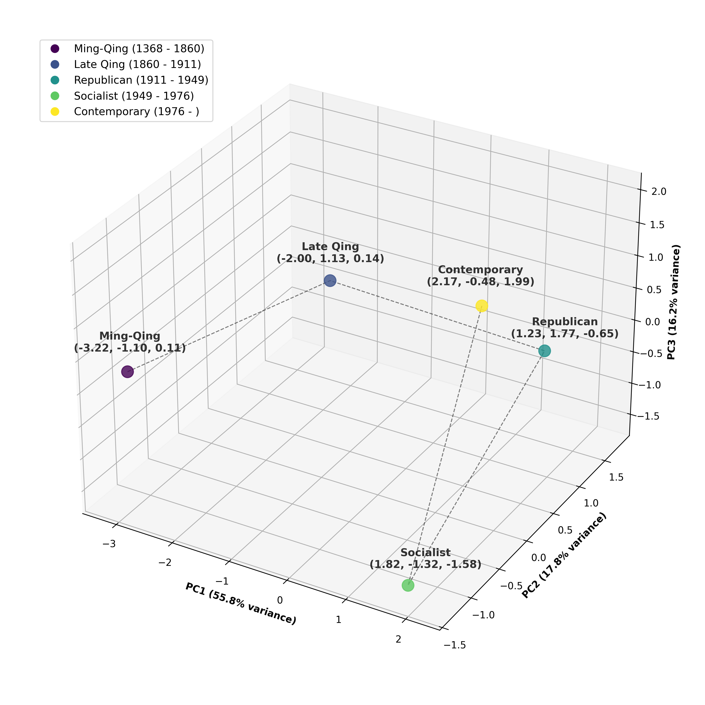

# Words Close to Heart

This project studies representations of interiority as a spatial and embodied problem: how do texts bring persons, emotions, and historical realities close to the reader's felt sense of self? Focusing on metaphors of the heart, mind, liver, stomach, and other inner organs, it treats empathy as a form of proximity that operates at once on the page, in semantic space, and through the reader's body schema. The larger theoretical aim is to move beyond a simple opposition between continuity and rupture in Chinese histories of emotion by showing how older cardiocentric vocabularies and newer models of mind are repeatedly reorganized in fiction.

## Geometries of Empathy from Classical Thought to Ye Xin’s *Wasted Years*

This article argues that Chinese fiction guides narrative empathy by bringing selected socio-political realities into proximity with interiority metaphors (e.g., "heart," "liver," "stomach"). This privileged zone spans three intertwined registers: the surface adjacency of words on the page, the geometric neighborhood of vectors in latent semantic space, and the felt extension of the reader's body schema into the fictional world. The argument proceeds in two steps. First, a word-embedding model trained on a large corpus of Chinese fiction traces the evolution of interiority metaphors from the Ming dynasty (1368–1644) to the present; their shifting positions in embedding space reveal both the concerns brought closest to the embodied self in each era and the continuities in how interiority has been imagined. Second, a close reading of Ye Xin's 葉辛 *Cuotuo suiyue* 蹉跎歲月 (Wasted Years, 1980), a representative work of scar literature, demonstrates how the novel cues readers to identify with certain characters more than others by allocating "heart-space" unevenly among the sent-down youths, cadre families, and local villagers. By linking computational models of semantic proximity to neurocognitive theories of embodied mind and the poetics of narrative attention, the article contributes to the techno-cognitive framework for the study of empathy in literature.

Kurzynski, Maciej. "Words Close to Heart: Geometries of Empathy in Chinese Literature, from Classical Thought to Ye Xin's *Wasted Years*," *Prism: Theory and Modern Chinese Literature* 23.1, special issue *Neurons and Texts: New Frontiers of Chinese Humanities*, forthcoming.

